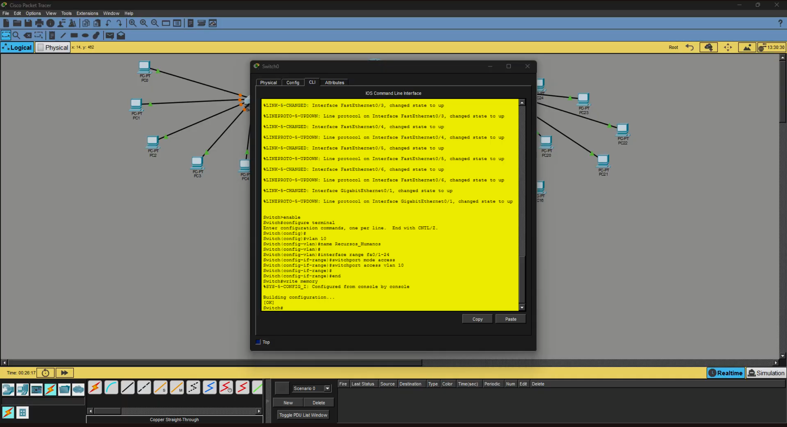
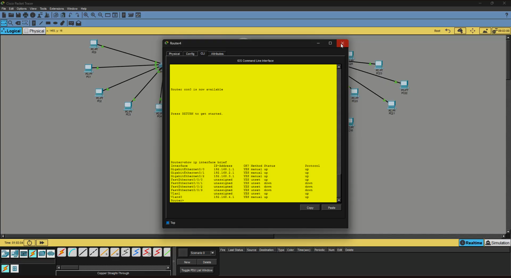
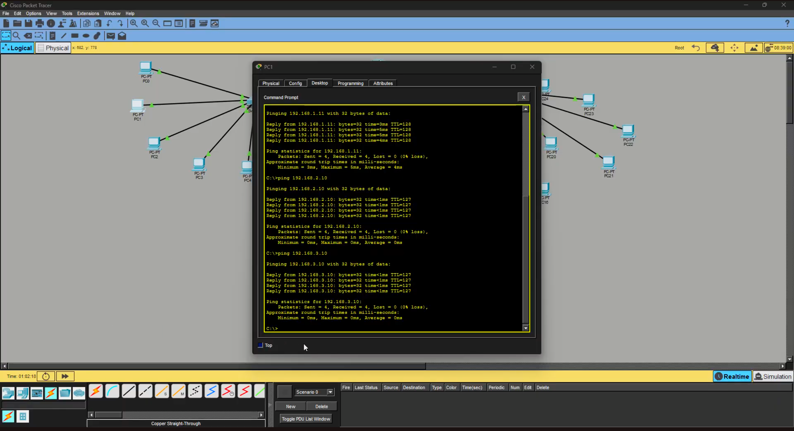

# Cisco Network Segmentation & Routing Lab

**Academic Project | Cisco Packet Tracer | 2026**

## Overview

This university networking lab uses Cisco Packet Tracer to model a multi-department network. The documented work covers configuring VLANs on switches, assigning IPv4 addresses and default gateways, inspecting router interfaces, and validating communication with ICMP ping tests.

**Project scope:** 1 Cisco 2911 router, 4 switches, and approximately 25 simulated workstations, based on the project overview. Screenshots are captured from an academic demonstration video.

> **Status:** **Project Status:** The Cisco Packet Tracer simulation file (`Cisco-Network-Segmentation-Routing-Lab.pkt`) and supporting screenshots are available in this repository. Documented ICMP connectivity tests show successful communication between tested subnets with 0% packet loss. A native VLAN mismatch warning was observed during the original laboratory demonstration and remains noted for further review.

## Technologies and skills

- Cisco Packet Tracer and Cisco IOS
- VLAN creation and switch access-port assignment
- IPv4 addressing, subnet masks, and default gateways
- Router interface inspection (`show ip interface brief`)
- VLAN verification (`show vlan brief`)
- ICMP connectivity testing and basic troubleshooting

## Network segmentation

| VLAN | Department | Subnet | Default gateway / router address shown |
| --- | --- | --- | --- |
| 10 | Human Resources | `192.168.1.0/24` | `192.168.1.1` |
| 20 | Marketing | `192.168.2.0/24` | `192.168.2.1` |
| 30 | Sales | `192.168.3.0/24` | `192.168.3.1` |
| 40 | Accounting | `192.168.4.0/24` | `192.168.4.1` |

The router CLI screenshot shows three GigabitEthernet interfaces with addresses ending in `.1` and a `Vlan40` interface using `192.168.4.1`. The exact end-to-end forwarding design should be verified against the original Packet Tracer file rather than assumed from screenshots alone.

## Configuration evidence

### Switch configuration: VLANs

| Evidence | Screenshot |
| --- | --- |
| VLAN 10 / Human Resources | [View](screenshots/01-vlan10-human-resources.png) |
| VLAN 20 / Marketing | [View](screenshots/02-vlan20-marketing.png) |
| VLAN 30 / Sales | [View](screenshots/03-vlan30-sales.png) |
| VLAN 40 / Accounting and native VLAN warning | [View](screenshots/04-vlan40-accounting-native-vlan-warning.png) |

### Router and workstation addressing

- [Router interface status — `show ip interface brief`](screenshots/05-router-ip-interfaces.png)
- [Example static IPv4 workstation configuration](screenshots/06-static-ip-configuration.png)

## Connectivity validation

The submitted evidence shows successful ICMP tests to hosts in different subnets. In the displayed tests, each set of four echo requests received four replies, with **0% packet loss**.

- [Multiple subnet ping tests](screenshots/07-inter-subnet-ping-tests.png)
- [Additional ping test](screenshots/08-additional-ping-test.png)

These results verify connectivity for the **documented source/destination pairs**, not every host or all possible traffic paths.

## Troubleshooting and limitations

A `%CDP-4-NATIVE_VLAN_MISMATCH` warning is visible in the VLAN 40 switch screenshot. This warning indicates inconsistent native VLAN settings on the connected interfaces at that point in the demonstration. The available screenshots do not establish whether the mismatch was later resolved. The appropriate follow-up is to review the relevant switchport modes and native VLAN settings in the original `.pkt` file.

The evidence does **not** establish implementation of ACLs, DHCP services, port security, security hardening, or other unshown features. Those capabilities are intentionally not claimed here.

## Source project file

The editable Cisco Packet Tracer `.pkt` file should be added to the repository once it is retrieved and reviewed. A fresh full-topology screenshot can also be added to show device interconnections without open configuration dialogs.

## Learning outcomes

This academic lab strengthened foundational skills in configuring Cisco network devices, segmenting a network with VLANs, verifying interface settings, and testing connectivity with command-line tools.
